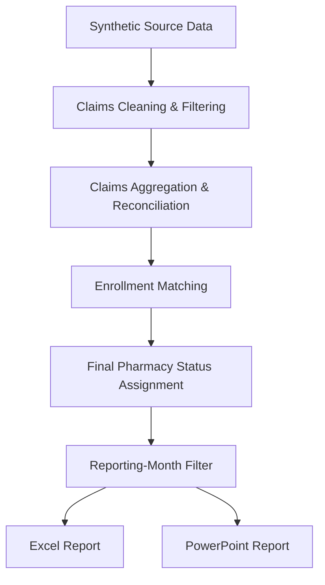
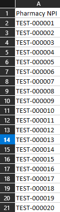
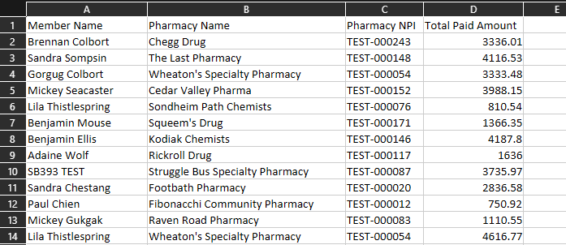
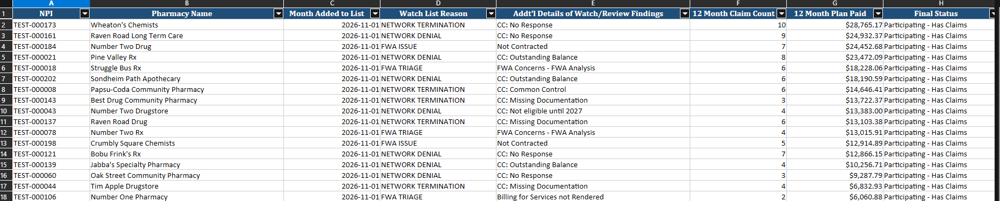
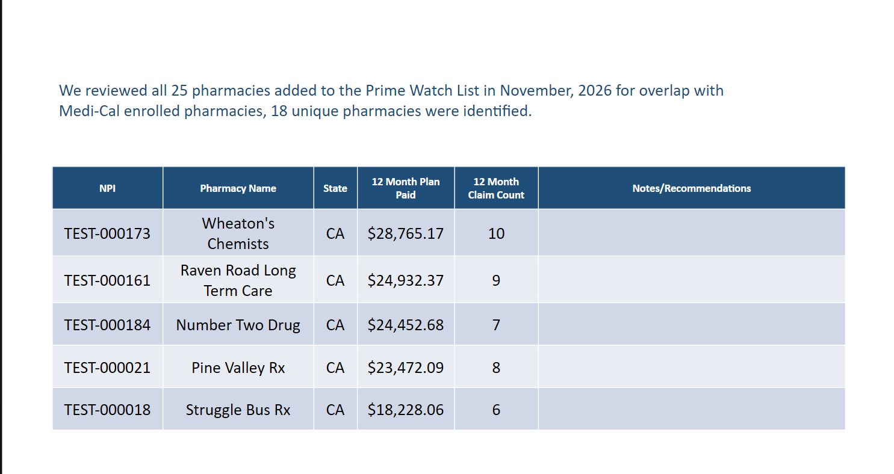

# Pharmacy Watchlist Analytics Pipeline

**A reproducible healthcare data analytics project built with Python, pandas, and automated reporting.**

The **Pharmacy Watchlist Analytics Pipeline** models a monthly healthcare analytics workflow: identify newly added pharmacies, determine network participation, analyze eligible pharmacy claims, and produce clear reporting deliverables.

The project uses **entirely synthetic data** to demonstrate how Python can reduce repetitive spreadsheet work, improve consistency, and make an analytical workflow more reproducible.

> **Project status:** Data generation, claims processing, Excel reporting, and core PowerPoint reporting are implemented. The single-command end-to-end orchestration workflow and final PowerPoint reference slide are still in development.

---

## Contents

- [Project Goals](#project-goals)
- [Technology Stack](#technology-stack)
- [How It Works](#how-it-works)
- [Current Capabilities](#current-capabilities)
- [Sample Outputs](#sample-outputs)
- [Project Structure](#project-structure)
- [Getting Started](#getting-started)
- [Running the Project](#running-the-project)
- [Development Roadmap](#development-roadmap)
- [Data Privacy](#data-privacy)

---

## Project Goals

This project aims to:

- Identify pharmacies added to a watchlist during a selected reporting month.
- Match pharmacy identifiers against an enrollment directory.
- Process claims data and apply defined business rules.
- Calculate claim counts and total plan-paid amounts by pharmacy.
- Validate processing results through reconciliation checks.
- Generate formatted Excel reports and PowerPoint presentations.
- Build toward a reproducible, end-to-end analytics pipeline.

## Technology Stack

| Technology | Purpose |
|---|---|
| **Python** | Core programming language |
| **Pandas** | Data manipulation, joins, filtering, and aggregation |
| **OpenPyXL** | Excel workbook generation and formatting |
| **Python-pptx** | PowerPoint presentation generation |
| **Git & GitHub** | Version control and project documentation |

---

## How It Works

The workflow is designed around a monthly pharmacy watchlist review.

The initial workflow retains manual Cognos report extraction. Python handles the downstream data processing and reporting.

### Processing sequence

1. **Generate synthetic data** — Create a pharmacy watchlist, enrollment directory, and Cognos-style claims dataset.
2. **Exclude test claims** — Normalize member names and remove records identified as `SB393 TEST`.
3. **Aggregate claims** — Group eligible claims by Pharmacy Name and Pharmacy NPI; calculate claim counts and total plan-paid amounts.
4. **Reconcile results** — Confirm aggregated claim counts and financial totals match the filtered source claims.
5. **Match enrollment** — Compare pharmacy NPIs against the enrollment directory while preserving all watchlist records.
6. **Assign final statuses** — Distinguish nonparticipating pharmacies, participating pharmacies with claims, and participating pharmacies without eligible claims.
7. **Filter the reporting month** — Select pharmacies added during the requested month.
8. **Generate deliverables** — Produce a formatted Excel report and a PowerPoint presentation.

---

## Current Capabilities

### Synthetic Data Generation

- Generates synthetic pharmacy enrollment, watchlist, and claims datasets.
- Uses fictional pharmacy names and test identifiers.
- Supports configurable watchlist reasons and review details.
- Uses configurable random seeds for reproducible test data.
- Exports generated datasets to Excel.
- Performs initial data-quality checks, including record counts, NPI uniqueness, and network participation counts.
- Provides a centralized `generate_synthetic_data()` function that returns the watchlist, enrollment, and claims DataFrames for downstream use.

### Claims Processing & Analytics

- Loads synthetic Cognos claims exports from Excel in the file-based processing workflow.
- Normalizes member names and excludes `SB393 TEST` records.
- Aggregates eligible claims by Pharmacy Name and Pharmacy NPI.
- Calculates claim counts and total plan-paid amounts.
- Sorts pharmacy results by plan-paid amount in descending order.
- Reconciles aggregated claim counts against source claim records.
- Reconciles aggregated financial totals against source claim amounts.

### Enrollment & Watchlist Processing

- Matches pharmacy NPIs against the enrollment directory.
- Uses left joins to preserve all pharmacies from the original watchlist.
- Identifies participating pharmacies with no eligible claims.
- Assigns final statuses:
  - Participating - Has Claims
  - Participating - No Claims
  - Not Participating
- Preserves blank claim metrics for nonparticipating pharmacies.
- Assigns zero claim counts and zero plan-paid amounts to participating pharmacies with no eligible claims.

### Excel Reporting

- Filters the processed watchlist to the selected reporting month.
- Supports dynamic reporting-month selection.
- Sorts by 12-month Plan Paid in descending order.
- Positions nonparticipating pharmacies at the bottom of the report.
- Selects client-facing columns and excludes internal processing fields.
- Applies custom column widths, styled headers, currency and date formatting.
- Freezes the header row and enables column filters.

### PowerPoint Reporting

- Generates a presentation with a reporting-month title slide.
- Creates a review summary showing the number of pharmacies reviewed and the number overlapping with the enrollment directory.
- Limits pharmacy tables to enrollment-matched pharmacies.
- Paginates tables with up to five pharmacies per slide.
- Applies custom column widths, navy headers, white header text, and alternating row shading.
- Formats plan-paid amounts as currency and claim counts as whole numbers.
- Centers table content horizontally and vertically.
- Includes a Notes/Recommendations column for review findings.

---

## Sample Outputs

The following screenshots use synthetic data and illustrate the project's inputs, processing checks, and reporting outputs.

### 1. Monthly Pharmacy Watchlist

### 2. Pharmacy Enrollment Directory

### 3. Watchlist Validation

### 4. Synthetic Claims Data

The generated Cognos-style claims export contains synthetic member names, pharmacy names, pharmacy NPIs, and total paid amounts.

### 5. Processed Pharmacy Watchlist — Excel

The final workbook contains pharmacies added during the selected reporting month, with enrollment and claims results, claim counts, and total plan-paid amounts.

### 6. PowerPoint Reporting Presentation

The presentation includes a reporting title slide, review summary, and paginated pharmacy tables.

---

## Project Structure

\`\`\`text
pharmacy-watchlist-capstone/
│
├── data/
│   ├── raw/                         # Generated synthetic source datasets
│   └── processed/                   # Intermediate datasets
│
├── docs/
│   └── screenshots/                 # README screenshots and sample outputs
│
├── output/                          # Generated reporting deliverables
│
├── src/
│   ├── generators/                  # Synthetic data generation
│   ├── processors/                  # Claims and watchlist processing
│   ├── reporting/                   # Excel and PowerPoint reporting
│   ├── validators/                  # Data validation
│   └── generate_data.py             # Synthetic data entry point
│
├── tests/                            # Project tests
├── demo.py                           # Project demonstration
├── orchestration.py                  # End-to-end workflow (in development)
├── requirements.txt
├── README.md
└── .gitignore
\`\`\`

Generated datasets and output files are excluded from version control. The repository focuses on source code, documentation, and reproducible workflows.

---

## Getting Started

### Prerequisites

- Python 3.10 or newer
- Git

### 1. Clone the repository

\`\`\`bash
git clone https://github.com/dee-wolf/pharmacy-watchlist-capstone.git
cd pharmacy-watchlist-capstone
\`\`\`

### 2. Create and activate a virtual environment

**Linux / WSL**

\`\`\`bash
python -m venv .venv
source .venv/bin/activate
\`\`\`

**Windows PowerShell**

\`\`\`powershell
python -m venv .venv
.venv\\Scripts\\Activate.ps1
\`\`\`

### 3. Install dependencies

\`\`\`bash
pip install -r requirements.txt
\`\`\`

### 4. Create the working directories

**Linux / WSL**

\`\`\`bash
mkdir -p data/raw data/processed output
\`\`\`

On Windows, create the same folders using File Explorer or your preferred terminal.

---

## Running the Project

### Generate synthetic data

From the repository root, with the virtual environment activated:

\`\`\`bash
python -m src.generate_data
\`\`\`

This runs the synthetic data generation workflow and writes the generated watchlist, enrollment directory, and claims dataset to `data/raw/`.

### Reporting modules

The Excel and PowerPoint reporting modules can also be run independently while the end-to-end orchestration workflow is being completed. Refer to each module's current command-line interface and arguments.

### End-to-end orchestration

The `orchestration.py` entry point is being developed to coordinate data generation, processing, and report creation in one run. It is not yet documented as a completed one-command workflow.

---

## Development Roadmap

- [x] Synthetic watchlist, enrollment, and claims data generation
- [x] Claims filtering and aggregation
- [x] Claim-count and plan-paid reconciliation
- [x] Enrollment matching and final status assignment
- [x] Dynamic reporting-month filtering
- [x] Formatted Excel report generation
- [x] PowerPoint title, summary, and paginated pharmacy tables
- [ ] Complete the end-to-end orchestration workflow
- [ ] Add the PowerPoint definitions and reference slide
- [ ] Expand automated testing and quality assurance
- [ ] Perform a fresh-clone test of the complete workflow and README instructions

---

## Data Privacy

This project uses **entirely synthetic data**. No real pharmacy identifiers, member information, claims records, or protected health information are used.

The project is intended for educational and portfolio demonstration purposes.
