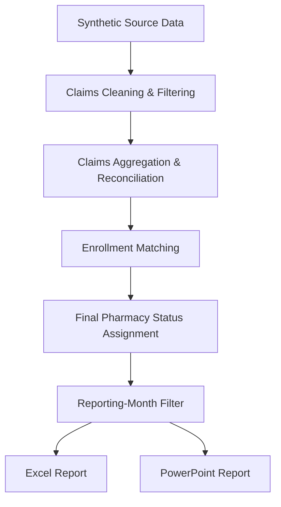
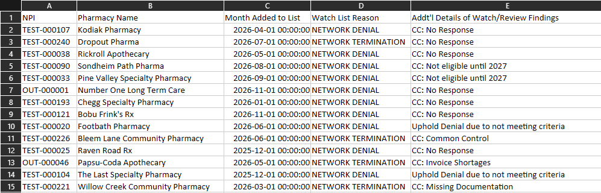

# Pharmacy Watchlist Analytics Pipeline

**A reproducible healthcare data analytics project built with Python, pandas, and automated reporting.**

[](https://www.python.org/)
[](https://pandas.pydata.org/)
[](https://openpyxl.readthedocs.io/)
[](https://python-pptx.readthedocs.io/)

The **Pharmacy Watchlist Analytics Pipeline** models a monthly healthcare analytics workflow: identify newly added pharmacies, determine network participation, analyze eligible pharmacy claims, and produce clear reporting deliverables.

The project uses **entirely synthetic data** to demonstrate how Python can reduce repetitive spreadsheet work, improve consistency, and make an analytical workflow more reproducible.

> **Project status:** Synthetic data generation, claims and enrollment processing, Excel and PowerPoint reporting, end-to-end orchestration, and a 40-test suite covering claims processing, watchlist processing, watchlist validation, and enrollment and watchlist generation are implemented. The synthetic workflow has passed a clean-room run from an empty generated-data/output state.

---

## Contents

- [Project Goals](#project-goals)
- [Technology Stack](#technology-stack)
- [How It Works](#how-it-works)
- [Current Capabilities](#current-capabilities)
- [Sample Outputs](#sample-outputs)
- [Project Structure](#project-structure)
- [Getting Started](#getting-started)
- [Running the Project](#running-the-project)
- [Testing](#testing)
- [Development Roadmap](#development-roadmap)
- [Data Privacy](#data-privacy)

---

## Project Goals

This project aims to:

- Identify pharmacies added to a watchlist during a selected reporting month.
- Match pharmacy identifiers against an enrollment directory.
- Process claims data and apply defined business rules.
- Calculate claim counts and total plan-paid amounts by pharmacy.
- Validate processing results through reconciliation checks.
- Generate formatted Excel reports and PowerPoint presentations.
- Run the complete synthetic workflow through a single command.
- Verify core processing behavior with automated tests.

## Technology Stack

| Technology | Purpose |
|---|---|
| **Python** | Core programming language |
| **Pandas** | Data manipulation, joins, filtering, and aggregation |
| **OpenPyXL** | Excel workbook generation and formatting |
| **Python-pptx** | PowerPoint presentation generation |
| **Pytest** | Automated unit testing and regression coverage |
| **Git & GitHub** | Version control and project documentation |

---

## How It Works

The workflow is designed around a monthly pharmacy watchlist review.



The initial workflow retains manual Cognos report extraction. Python handles the downstream data processing and reporting.

### Processing sequence

1. **Generate synthetic data** — Create a pharmacy watchlist, enrollment directory, and Cognos-style claims dataset.
2. **Exclude test claims** — Normalize member names and remove records identified as `SB393 TEST`.
3. **Aggregate claims** — Group eligible claims by Pharmacy Name and Pharmacy NPI; calculate claim counts and total plan-paid amounts.
4. **Reconcile results** — Confirm aggregated claim counts and financial totals match the filtered source claims.
5. **Match enrollment** — Compare pharmacy NPIs against the enrollment directory while preserving all watchlist records.
6. **Assign final statuses** — Distinguish nonparticipating pharmacies, participating pharmacies with claims, and participating pharmacies without eligible claims.
7. **Filter the reporting month** — Select pharmacies added during the requested month.
8. **Generate deliverables** — Produce a formatted Excel report and a PowerPoint presentation.

---

## Current Capabilities

### Synthetic Data Generation

- Generates synthetic pharmacy enrollment, watchlist, and claims datasets.
- Uses fictional pharmacy names and test identifiers.
- Supports configurable watchlist reasons and review details.
- Uses configurable random seeds for reproducible test data.
- Exports generated datasets to Excel.
- Performs initial data-quality checks, including record counts, NPI uniqueness, and network participation counts.
- Provides a centralized `generate_synthetic_data()` function that returns the watchlist, enrollment, and claims DataFrames for downstream use.

### Claims Processing & Analytics

- Loads synthetic Cognos claims exports from Excel in the file-based processing workflow.
- Normalizes member names and excludes `SB393 TEST` records.
- Aggregates eligible claims by Pharmacy Name and Pharmacy NPI.
- Calculates claim counts and total plan-paid amounts.
- Sorts pharmacy results by plan-paid amount in descending order.
- Reconciles aggregated claim counts against source claim records.
- Reconciles aggregated financial totals against source claim amounts.
- Converts numeric-string payment values to numeric types before aggregation.
- Rejects missing or non-numeric payment amounts and negative payments.
- Validates that each pharmacy NPI maps to only one pharmacy name, while allowing one pharmacy name to have multiple NPIs.
- Preserves the original input DataFrame during payment normalization.

### Enrollment & Watchlist Processing

- Matches pharmacy NPIs against the enrollment directory.
- Uses left joins to preserve all pharmacies from the original watchlist.
- Identifies participating pharmacies with no eligible claims.
- Assigns final statuses:
  - Participating - Has Claims
  - Participating - No Claims
  - Not Participating
- Preserves blank claim metrics for nonparticipating pharmacies.
- Assigns zero claim counts and zero plan-paid amounts to participating pharmacies with no eligible claims.

### Excel Reporting

- Filters the processed watchlist to the selected reporting month.
- Supports dynamic reporting-month selection.
- Sorts by 12-month Plan Paid in descending order.
- Positions nonparticipating pharmacies at the bottom of the report.
- Selects client-facing columns and excludes internal processing fields.
- Applies custom column widths, styled headers, currency and date formatting.
- Freezes the header row and enables column filters.

### PowerPoint Reporting

- Generates a presentation with a reporting-month title slide.
- Creates a review summary showing the number of pharmacies reviewed and the number overlapping with the enrollment directory.
- Limits pharmacy tables to enrollment-matched pharmacies.
- Paginates tables with up to five pharmacies per slide.
- Applies custom column widths, navy headers, white header text, and alternating row shading.
- Formats plan-paid amounts as currency and claim counts as whole numbers.
- Centers table content horizontally and vertically.
- Includes a Notes/Recommendations column for review findings.
- Appends a definitions/reference slide after the pharmacy tables.

---

## Sample Outputs

The following screenshots use synthetic data and illustrate the project's inputs, processing checks, and reporting outputs.

### 1. Monthly Pharmacy Watchlist



### 2. Pharmacy Enrollment Directory


### 3. Watchlist Validation


### 4. Synthetic Claims Data

The generated Cognos-style claims export contains synthetic member names, pharmacy names, pharmacy NPIs, and total paid amounts.


### 5. Processed Pharmacy Watchlist — Excel

The final workbook contains pharmacies added during the selected reporting month, with enrollment and claims results, claim counts, and total plan-paid amounts.


### 6. PowerPoint Reporting Presentation

The presentation includes a reporting title slide, review summary, and paginated pharmacy tables.


---

## Project Structure

```text
pharmacy-watchlist-capstone/
│
├── data/
│   ├── raw/                         # Generated synthetic source datasets
│   └── processed/                   # Intermediate datasets
│
├── docs/
│   └── screenshots/                 # README screenshots and sample outputs
│
├── output/                          # Generated reporting deliverables
│
├── src/
│   ├── generators/                  # Synthetic data generation
│   ├── processors/                  # Claims and watchlist processing
│   ├── reporting/                   # Excel and PowerPoint reporting
│   ├── validators/                  # Data validation
│   └── generate_data.py             # Synthetic data entry point
│
├── tests/                           # Automated tests
│   ├── __init__.py
│   ├── test_claims_processor.py
│   ├── test_watchlist_processor.py
│   └── test_watchlist_validator.py
├── demo.py                          # Project demonstration
├── orchestration.py                 # End-to-end workflow entry point
├── pytest.ini                       # Pytest configuration
├── requirements.txt
├── README.md
└── .gitignore
```

---

## Getting Started

### Prerequisites

- Python 3.10 or newer
- Git

### 1. Clone the repository

```bash
git clone https://github.com/dee-wolf/pharmacy-watchlist-capstone.git
cd pharmacy-watchlist-capstone
```

### 2. Create and activate a virtual environment

**Linux / WSL**

```bash
python -m venv .venv
source .venv/bin/activate
```

**Windows PowerShell**

```powershell
python -m venv .venv
.venv\\Scripts\\Activate.ps1
```

### 3. Install dependencies

```bash
pip install -r requirements.txt
```

### 4. Create the working directories

**Linux / WSL**

```bash
mkdir -p data/raw data/processed output
```

On Windows, create the same folders using File Explorer or your preferred terminal.

---

## Running the Project

### Generate synthetic data

From the repository root, with the virtual environment activated:

```bash
python -m src.generate_data
```

This runs the synthetic data generation workflow and writes the generated watchlist, enrollment directory, and claims dataset to `data/raw/`.

### Reporting modules

The Excel and PowerPoint reporting modules can also be run independently while the end-to-end orchestration workflow is being completed. Refer to each module's current command-line interface and arguments.

### End-to-end orchestration

Run the complete synthetic workflow from the repository root:

```bash
python orchestration.py 2026-11
```

Pass the reporting month as `YYYY-MM`. The orchestration entry point generates the synthetic watchlist, enrollment directory, and claims data; performs enrollment matching, claims filtering and aggregation, and reconciliation; filters the selected reporting month; and creates both reporting deliverables in `output/`:

- `pharmacy_watchlist_2026-11.xlsx`
- `pharmacy_watchlist_2026-11.pptx`

The filenames use the reporting month supplied to the command. The workflow uses generated synthetic data and does not automate extraction from Cognos; the initial workflow retains manual Cognos report extraction for a real-data process.

---

## Testing

The project uses **pytest** for automated tests. The repository includes a project-level `pytest.ini` that directs test discovery to the `tests/` directory and configures the repository root on the Python import path.

Run the test suite from the repository root with the virtual environment activated:

```bash
pytest -v
```

The current suite contains **40 automated tests** across the claims processor, watchlist processor, watchlist validator, enrollment generator, and watchlist generator.

### Claims processor tests — 12 tests

Claims-filtering tests for `exclude_test_claims()` verify:

- Ordinary member claims are retained while `SB393 TEST` records are excluded regardless of surrounding whitespace or letter case.
- All-test-claim input produces an empty DataFrame.
- The original input DataFrame remains unchanged.

Claims-aggregation tests for `aggregate_claims()` verify:

- Correct grouping by pharmacy name and NPI, claim counts, plan-paid totals, and descending sort order.
- Zero-dollar claims and empty input DataFrames.
- Rejection of missing or non-numeric payment amounts.
- Conversion of numeric strings to numeric values before aggregation.
- Rejection of negative payment amounts, which should not appear because reversals and adjustments are excluded upstream.
- Rejection of an NPI associated with multiple pharmacy names.
- Acceptance of one pharmacy name associated with multiple NPIs.
- Preservation of the original input DataFrame during processing.

### Watchlist processor tests — 9 tests

Enrollment-matching tests for `match_enrollment()` verify:

- All original watchlist records are preserved by the left merge.
- The original watchlist and enrollment DataFrames remain unchanged.
- Enrollment matches and unmatched NPIs receive the expected merge indicators.
- An empty watchlist produces an empty result with the expected output columns.

Claims/watchlist merge tests for `merge_claims_with_watchlist()` verify:

- Claims counts and plan-paid amounts are merged onto the correct pharmacy NPIs.
- Pharmacies without a matching claims record remain in the result with missing claims metrics.
- The original enrollment-matched watchlist and aggregated claims DataFrames remain unchanged.

### Watchlist validator tests — 5 tests

Tests for `validate_watchlist()` verify:

- A valid watchlist passes all validation checks.
- An incorrect total record count raises `ValueError`.
- Duplicate pharmacy NPIs raise `ValueError`.
- An incorrect participating pharmacy count raises `ValueError`.
- An incorrect nonparticipating pharmacy count raises `ValueError`.

### Enrollment generator tests

Tests for `generate_enrollment()` verify:

- Successful generation of the requested number of pharmacy records.
- The default generation count of 250 pharmacies.
- The expected `Pharmacy NPI` output column.
- Unique generated NPIs.
- Correct first and last NPI formatting.
- Creation of the exported `data/raw/enrolled_pharmacies.xlsx` workbook.
- Rejection of non-integer inputs, including strings and booleans, with `TypeError`.
- Rejection of zero and negative pharmacy counts with `ValueError`.

### Watchlist generator tests — 4 tests

Tests for `generate_watchlist()` verify:

- Boolean input for `num_pharmacies` is rejected with `TypeError`.
- Boolean input for `participating_count` is rejected with `TypeError`.
- A string value for `seed` raises `TypeError` when the generator attempts to derive its independent random seeds.
- A non-string `reporting_month` is rejected with `TypeError`.

Run `pytest -v` from the repository root to execute all 40 tests. Automated coverage for the remaining generators and reporting modules remains future work.

### Clean-room workflow check

The synthetic end-to-end workflow was manually verified after clearing the generated files from `data/raw/` and `output/`. Running `python orchestration.py 2026-11` regenerated the synthetic source workbooks and both reporting deliverables, with claim-count and plan-paid reconciliation checks passing. This verifies regeneration within the existing development environment; it is not a fresh-machine installation test.

---

## Development Roadmap

- [x] Synthetic watchlist, enrollment, and claims data generation
- [x] Claims filtering and aggregation
- [x] Claim-count and plan-paid reconciliation
- [x] Enrollment matching and final status assignment
- [x] Dynamic reporting-month filtering
- [x] Formatted Excel report generation
- [x] PowerPoint title, summary, paginated pharmacy tables, and definitions/reference slide
- [x] End-to-end orchestration for synthetic data generation, processing, and Excel/PowerPoint reporting
- [x] Pytest setup and 40 automated tests covering claims filtering and aggregation, enrollment matching, claims merging, final status assignment, watchlist validation, enrollment generation, watchlist generator input handling, financial data validation, NPI/name integrity, empty inputs, input preservation, and generated-file creation
- [x] Clean-room run of the synthetic orchestration workflow after clearing generated inputs and outputs
- [x] Add automated tests for final status assignment and watchlist validation
- [x] Add automated tests for the enrollment generator
- [x] Add initial automated tests for watchlist generator input handling
- [ ] Expand watchlist generator coverage and add tests for the remaining generators and reporting
- [ ] Perform a fresh-clone installation test of the complete workflow and README instructions

---

## Data Privacy

This project uses **entirely synthetic data**. No real pharmacy identifiers, member information, claims records, or protected health information are used.

The project is intended for educational and portfolio demonstration purposes.
