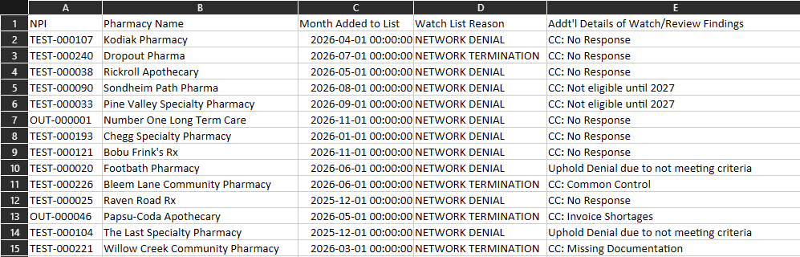
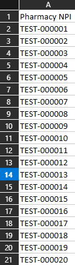

# Pharmacy Watchlist Analytics Pipeline

## Overview

The Pharmacy Watchlist Analytics Pipeline is a Python-based data analytics project designed to streamline the monthly process of identifying newly added pharmacies, determining network participation, and analyzing pharmacy claims activity.

The project is modeled after a real-world healthcare analytics workflow and uses entirely synthetic data to demonstrate how Python and pandas can be applied to automate repetitive data preparation, data validation, aggregation, and reporting tasks.

The goal is to reduce manual spreadsheet work, improve consistency, and create a more reproducible reporting process.

## Project Objectives

This project aims to:

- Identify pharmacies added to a watchlist during a selected reporting month.
- Determine pharmacy participation by matching pharmacy identifiers against an enrollment directory.
- Prepare pharmacy identifiers and reporting dates for claims extraction.
- Process claims data, apply business rules, and calculate claim counts and total plan-paid amounts.
- Generate structured Excel reports and client-facing PowerPoint presentations.
- Incorporate data validation and quality checks to improve reporting accuracy.

## Technology Stack

- **Python** – Core programming language
- **Pandas** – Data manipulation, merging, and aggregation
- **OpenPyXL** – Excel workbook processing
- **Python-pptx** – PowerPoint report generation
- **Git & GitHub** – Version control and project management

## Current Capabilities

### Synthetic Data Generation

- Configurable synthetic pharmacy enrollment directory generation.
- Monthly pharmacy watchlist generation.
- Synthetic pharmacy names and test identifiers.
- Configurable watchlist reasons and associated review details.
- Weighted random selection of watchlist categories.
- Reproducible data generation using configurable random seeds.
- Excel export of generated datasets.
- Initial data-quality validation, including record counts, NPI uniqueness, and network participation counts.

### Claims Processing and Analytics

- Loading synthetic Cognos claims exports from Excel.
- Identifying and excluding `SB393 TEST` claims using normalized member names.
- Aggregating eligible claims by Pharmacy Name and Pharmacy NPI.
- Calculating claim counts and total plan-paid amounts.
- Sorting pharmacy results by total plan-paid amount in descending order.
- Reconciling aggregated claim counts against source claim records.
- Reconciling aggregated financial totals against source claim amounts.
- Matching watchlist pharmacies against the Medi-Cal enrollment directory.
- Preserving all watchlist pharmacies through left joins, including pharmacies without claims activity.

## Current Processing Workflow

The project currently implements the following workflow:

1. **Generate Synthetic Data:** Create fictional pharmacy watchlists, enrollment directories, member names, and claims records.
2. **Load Claims Data:** Import the synthetic Cognos claims export into pandas.
3. **Exclude Test Claims:** Normalize member names and remove records identified as `SB393 TEST`.
4. **Aggregate Claims:** Group eligible claims by Pharmacy Name and Pharmacy NPI, calculating claim counts and total plan-paid amounts.
5. **Reconcile Results:** Validate that aggregated claim counts and financial totals match the filtered source claims.
6. **Match Enrollment:** Compare pharmacy NPIs against the Medi-Cal enrollment directory.
7. **Merge Results:** Use left joins to preserve all pharmacies in the original watchlist, including pharmacies without matching claims records.

The initial workflow retains manual Cognos report extraction. Python handles the downstream data processing and analysis.

## Project Structure

```text
pharmacy-watchlist-capstone/
│
├── data/
│   ├── raw/                     # Generated synthetic source datasets
│   └── processed/               # Intermediate datasets
│
├── docs/
│   └── screenshots/             # README screenshots and sample outputs
│       ├── monthly_watchlist.png
│       ├── enrolled_pharmacies.png
│       ├── watchlist_validation.png
│       └── claims_output.png
│
├── output/                      # Final reporting deliverables
│
├── src/
│   ├── generators/
│   │   ├── __init__.py
│   │   ├── claims.py
│   │   ├── enrollment.py
│   │   ├── member_names.py
│   │   ├── name_parts.py
│   │   ├── watchlist.py
│   │   └── watchlist_reasons.py
│   │
│   ├── processors/
│   │   ├── __init__.py
│   │   ├── claims_processor.py
│   │   └── watchlist_processor.py
│   │
│   ├── validators/
│   │   ├── __init__.py
│   │   └── watchlist_validator.py
│   │
│   └── generate_data.py
│
├── tests/
│
├── .gitignore
├── README.md
└── requirements.txt
```

### Directory Descriptions

- **data/raw/** – Synthetic source datasets used to simulate monthly reporting inputs.
- **data/processed/** – Intermediate datasets generated during processing.
- **docs/screenshots/** – Visual examples of synthetic data and project outputs.
- **output/** – Final reporting deliverables.
- **src/generators/** – Modules responsible for generating synthetic source data.
- **src/processors/** – Modules responsible for loading, filtering, merging, and aggregating datasets.
- **src/validators/** – Data validation functions.
- **tests/** – Project testing and quality assurance.

Generated datasets and output files are excluded from version control to keep the repository focused on source code, documentation, and reproducible workflows.

## Sample Outputs

### Monthly Pharmacy Watchlist



### Pharmacy Enrollment Directory



### Watchlist Validation Results


### Synthetic Claims Output

The generated Cognos-style claims export contains synthetic member names, pharmacy names, pharmacy NPIs, and total paid amounts.


## Upcoming Development

1. Complete enrollment and claims integration, including identification of participating pharmacies with no claims activity.
2. Apply appropriate zero-claim handling while preserving nonparticipating pharmacy status.
3. Generate the final formatted Excel reporting workbook.
4. Develop automated PowerPoint presentation generation.
5. Expand automated testing and quality assurance.
6. Improve processing documentation and reporting reproducibility.

## Data Privacy

This project uses entirely synthetic data. No real pharmacy identifiers, member information, claims records, or protected health information are used.

The project is intended for educational and portfolio demonstration purposes.
